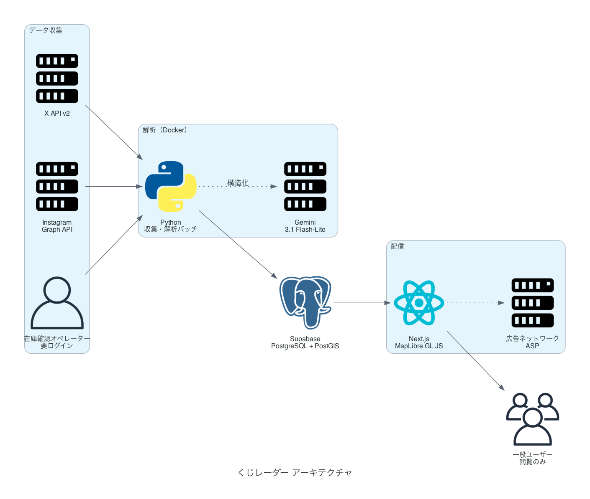

# くじレーダー

**SNS投稿をAIが解析し、一番くじの在庫ステータスを地図上に可視化するWebサービス。**

お目当てのくじを求めて何軒もハシゴする徒労と、「在庫ありますか？」という電話に追われる店舗の負担。  
その両方を、SNSに流れている情報を構造化することで解消します。

> 着想は金融の **オルタナティブデータ分析** （SNSテキストから市場の動きを推測する手法）にあります。  
> 「バラバラのテキストから現実の数値を推測する」という構造を、そのまま在庫推測に応用しています。

## 目次

- [現在のステータス](#現在のステータス)
- [サービスの形](#サービスの形)
- [アーキテクチャ](#アーキテクチャ)
- [技術スタックと選んだ理由](#技術スタックと選んだ理由)
- [位置データの扱い](#位置データの扱い)
- [AI の判定を信じすぎない仕組み](#ai-の判定を信じすぎない仕組み)
- [予備調査](#予備調査)
- [認証](#認証)
- [テストと CI](#テストと-ci)
- [今後の改善](#今後の改善)
- [開発する](#開発する)

---

## 現在のステータス

🚧 **開発中のデモを公開しています。**

X API / Instagram Graph API の利用料をまかなう資金が足りず、実データの収集を始められていません（クラウドファンディングを試しましたが、集まりませんでした）。  
**地図に出る在庫はすべてサンプルデータです。**

公開URL:  
https://kuji-radar-850436172419.asia-northeast1.run.app

---

## サービスの形

| | 内容 |
| :--- | :--- |
| **一般ユーザー（未ログイン）** | 地図・店舗詳細・「A賞あり」フィルタを **登録なしで** 使える |
| **一般ユーザー（プレミアム）** | 上記に加えて、 **お気に入り店舗の登録** と **在庫急変のプッシュ通知** 。月額390円 |
| **オペレーター** | 在庫確認コンソール（要ログイン）から、電話確認した残り本数とA賞の有無を入力する |
| **収益** | 広告・プレミアムプラン・B2B（店舗掲載枠）の3本 |

**無料機能を人質に取らない** 設計です。  
地図を見たいだけの人は登録せずに使えるので離脱しません。  
課金するのは、特定の店を張っている層だけになります。

在庫判定は **単一の投稿を鵜呑みにしません** 。  
複数投稿のクロス検証と鮮度減衰を通し、確信度の低い情報は表示しません。  
判定の根拠になった投稿は必ず開示します（詳しくは「[AI の判定を信じすぎない仕組み](#ai-の判定を信じすぎない仕組み)」）。

### 立ち上げ期は、電話確認が品質を担保する

予備調査で、 **一般ユーザーの投稿からは店舗をほぼ特定できない** ことが分かりました。  
残数は書いても、店名は書かないためです。  
店舗が特定できるのは、店舗アカウント自身の投稿にほぼ限られます。

つまり **公開初期は、SNSだけでは地図が埋まりません。**  
この期間の品質は、 **オペレーターの電話確認（確定情報）が担保します。**

利用者が増えれば、投稿量そのものが増えます。  
店舗側も告知の効果を実感して、発信を増やすはずです。  
そのため **SNSの比重は時間とともに上がる** 見込みです。  
電話確認は恒久的な主力ではなく、 **その立ち上がりまでの橋渡し** という位置づけです。

> ⚠️ この見立ては n=24 の予備調査に基づく仮説です。 **確定値ではありません。**  
> 正式な数字は、資金が集まったあとに X API での実測で確定させます。

---

## アーキテクチャ



UIはSNSのAPIを直接呼ばず、 **常に「解析済みの結果」だけを見ます** 。  
この分離により、収集基盤が完成する前にフロントを作り切れます。

いまは `MockDataSource` が刺さっており、`DATABASE_URL` を設定すれば `NeonDataSource` に切り替わります。  
**UI側は一行も変わりません。**

```
[X API / IG Graph API] → [Gemini解析バッチ(Python)] → [Neon] → DataSource → aggregate() → API Route → UI
```

- DBには AI の「素の判定」だけを置きます。<br>クロス検証・鮮度減衰・確信度の計算は、[`aggregate.ts`](web/src/lib/aggregate.ts) の1か所で行います（ロジックを1か所に保つため）
- 投稿の生データ（`posts_raw`）と解析結果（`analyzed_posts`）は、テーブルを分けています。<br>X API は1件読むごとに課金されます。プロンプトやモデルを変えて再解析するとき、投稿を取り直さずに済むようにするためです

---

## 技術スタックと選んだ理由

| 技術 | 使い方 | 選んだ理由 |
| :--- | :--- | :--- |
| **Next.js** （App Router） | 地図・LP・管理画面と、API（Route Handler）を1つのアプリに同居させる。<br>`output: "standalone"` でコンテナ化する | standalone 出力は、実行に必要なファイルだけをイメージに入れるため（[next.config.ts](web/next.config.ts)、[Dockerfile](web/Dockerfile)） |
| **Cloud Run** | Web アプリを Cloud Run サービス、収集・解析バッチを Cloud Run Jobs として置く。<br>どちらも同じ GCP プロジェクト・同じリージョン（asia-northeast1）・同じ Artifact Registry | ① Python のバッチと Web アプリを **同じ GCP に寄せる** ため。1本のワークフロー（[deploy.yml](.github/workflows/deploy.yml)）と同じ Workload Identity 連携で、両方をデプロイしている。<br>② Node ランタイムで動くので、DB ドライバに TCP 接続の `pg` を使える。 **ローカルの Docker の Postgres と Neon の両方に、同じコードで繋げる** （[neon.ts](web/src/lib/data/neon.ts)） |
| **Neon + PostGIS** | 店舗・投稿・解析結果・電話確認・利用者を保存する。<br>店舗位置は `geography(Point, 4326)` | 「現在地から半径N km」を、メートルで指定して引くため（[位置データの扱い](#位置データの扱い)）。<br>接続は pooled（`-pooler`）を使う。Cloud Run はインスタンスが増減し、直結だと接続数の上限に当たるため |
| **Gemini** | 投稿本文（と画像）から、店舗の手がかり・在庫ステータス・A賞の有無・確信度を構造化して返させる。<br>既定のモデルは `gemini-3.1-flash-lite`、`temperature=0.0` | 決まった形の JSON を返させる Structured Output と、画像（くじ台紙の写真）の読み取りを使うため。<br>解析費用は1投稿あたり約0.03円と試算している。X API の取得費（約0.75円/件）のほうが大きい（[analyze_posts.py](scripts/analyze_posts.py)） |
| **Python** （pipeline） | 収集・解析・名寄せ・DB書き込みのバッチ。<br>Python 3.15、Pydantic、`google-genai` | Pydantic のモデルを、そのまま Gemini の出力スキーマに渡せるため（[schema.py](scripts/schema.py)）。<br>テストは pytest を足さず、標準の `unittest` を使う（Docker イメージを軽く保つため） |
| **Web Push** （VAPID） | お気に入り店舗の在庫が変わったら通知する。<br>`web-push` ライブラリで送信する | 外部の通知サービスを使わず、VAPID 鍵だけで送れるため。<br>鍵が無くてもアプリは動き、通知だけが無効になる（[push.ts](web/src/lib/push.ts)） |

---

## 位置データの扱い

### PostGIS の geography で持つ

店舗の位置は、緯度・経度を別のカラムにしていません。  
PostGIS の `geography(Point, 4326)` に入れ、GiST インデックスを張っています（[02_schema.sql](db/init/02_schema.sql)）。

```sql
  -- 緯度経度を別カラムで持たず geography に寄せる。
  -- 「現在地から半径N km」を ST_DWithin で引くのが主用途で、
  -- geography なら距離をメートルで直接指定できる（球面計算）
  location    geography(Point, 4326) NOT NULL,
```

```sql
-- 近傍検索用。これが無いと店舗が増えたとき全件走査になる
CREATE INDEX IF NOT EXISTS stores_location_idx ON stores USING GIST (location);
```

**geography を選んだ理由**

- 主な用途は「現在地から半径N km以内の店舗」です。geography なら、距離を **メートルで直接** 指定できます
- geometry は平面で計算するので速いです。ただし、メートルで扱うには投影座標系への変換が要ります
- 店舗が数千件規模なら、geography の球面計算の重さは問題になりません

店舗名の表記ゆれに備えて、`pg_trgm` の GIN インデックスも店舗名に張っています。

### 今の検索は全件を返している（未実装）

いまは [`listStores()`](web/src/lib/data/neon.ts) が全店舗を返しています。  
コードに次の TODO が残っています。

```ts
    // ⚠️ 全件返している。店舗が増えたら ST_DWithin で現在地から絞ること
    //    （数千件のピンをフロントに渡すと破綻する）。
```

次は `listStoresNear(lat, lng, radiusM)` を足し、`ST_DWithin` で現在地から絞り込みます。  
全件を返す今の実装は、管理画面用に残します。

### 店舗マスターは1か所から生成する

店舗の一覧は、[`scripts/data/stores.json`](scripts/data/stores.json) だけが正です。  
[`gen_stores.py`](scripts/gen_stores.py) がそこから、次の2つを生成します。

- 画面とモックが読む TypeScript（`stores.generated.ts`）
- DB の初期データ（`03_seed.sql`）。`ST_SetSRID(ST_MakePoint(lng, lat), 4326)::geography` で投入する

生成し忘れは CI が検出します。

**店舗データはデモ用の値です。**

### 地図タイル

[`MapView.tsx`](web/src/components/MapView.tsx) は、MapTiler のキー（`NEXT_PUBLIC_MAPTILER_KEY`）があればベクタータイルを使います。  
無ければ、OSM 公式のラスタタイル（`tile.openstreetmap.org`）にフォールバックします。  
**いまはキーが未設定で、OSM 公式タイルを使っています。**

OSM の公式タイルは、寄付で運営される無保証のサービスです。大量のアクセスを前提にしていません。  
公開して利用者が増えるなら、有料の配信サービス（MapTiler など）か、自前のタイル配信に替えます。

---

## AI の判定を信じすぎない仕組み

### 決まった形で返させ、確信度も出させる

Gemini には、Pydantic のモデル（[schema.py](scripts/schema.py) の `Analysis`）を出力スキーマとして渡します。  
これで、決まった形の JSON だけを返させます。

返す項目は次のとおりです。

- 在庫に関係あるか
- 店舗の表記・地名・タイトル
- 在庫ステータス・残り本数・A賞の有無
- **確信度**
- 判定の根拠（一文）

受け取った結果は、`Analysis.model_validate_json()` で検証します。

プロンプトでは、店舗が特定できなければ推測で埋めないこと、過去の話は確信度を下げることを指示しています。

```
- 店舗が特定できない場合、store_hint は null にする。推測で埋めないこと
- confidence は「その店舗のその在庫状況が事実である」ことへの確信度
- 過去の話（「先週行ったら」等）は在庫情報として鮮度がないため confidence を下げる
```

AI が返すのは、 **店舗の表記（文字列）まで** です。  
どの店舗かを決めるのは AI ではなく、[`pipeline.py`](scripts/pipeline.py) の名寄せ（`match_store`）です。  
店舗マスターとの一致度が `MATCH_THRESHOLD = 0.7` に届かなければ、「特定できなかった」として地図に出しません。  
誤った店舗に出すのは、情報が無いことより有害だからです。

### 集計で確信度を補正する

個々の判定は、そのまま地図に出しません。[`aggregate.ts`](web/src/lib/aggregate.ts) で集計してから出します。  
定数はコードのまま引用します。

```ts
/** SNS推測の有効期間。これを過ぎたら「情報不足」に落とす */
export const FRESH_WINDOW_HOURS = 12;

/** 電話確認（確定情報）の有効期間。発売日は在庫が速く動くため短くとる */
export const VERIFIED_WINDOW_HOURS = 6;

/** これ未満の確信度は表示しない。空振りによる信頼低下を防ぐ */
export const MIN_CONFIDENCE = 0.4;

/** 鮮度窓の終端における確信度の残存率 */
const DECAY_FLOOR = 0.5;

/** 複数投稿が一致したときの加点（1件増えるごと） */
const CROSS_CHECK_BONUS = 0.04;

/** 確信度の上限。推測である以上100%にはしない */
const CONFIDENCE_CEILING = 0.97;

const SOURCE_WEIGHT: Record<SourceKind, number> = {
  x: 1.0,
  instagram: 0.85,
};
```

| 仕組み | 内容 |
| :--- | :--- |
| クロス検証 | 同じ店舗について、同じ判定の投稿が1件増えるごとに +0.04 |
| 上限 | 確信度は 0.97 で頭打ち。推測である以上、100% にはしない |
| 鮮度減衰 | 投稿からの経過時間に応じて確信度を下げ、12時間で 0.5 倍まで下がる。<br>12時間を過ぎた投稿は使わず、その店舗は「情報不足」に戻る |
| 表示の下限 | 補正後の確信度が 0.4 未満なら表示しない |
| 情報源の重み | Instagram は 0.85 倍。<br>ハッシュタグ起点で、店舗の特定を本文に頼れない分、低く見る |
| 確定情報の優先 | オペレーターの電話確認（6時間有効）があれば、AI の推測より優先する |

### 判定の根拠を必ず画面に出す

店舗詳細（[StoreSheet.tsx](web/src/components/StoreSheet.tsx)）では、判定の元になった投稿をそのまま表示します。  
あわせて、「AI推測」「電話確認済み（確定情報）」のどちらかを明示します。  
推測が外れることを前提に、利用者が自分で判断できる材料を渡すためです。

### 限界：投稿1件だけでも表示されうる

クロス検証は **加点** であって、複数の投稿の一致を **必須** にはしていません。  
1件の投稿でも、補正後の確信度が 0.4 以上なら地図に出ます。

また、スキーマの `confidence` には「0.0〜1.0」という説明があるだけで、範囲の検査はしていません。  
上限 0.97 は、集計側で効きます。

### プロンプトインジェクション： **未対策**

投稿の本文は、`投稿本文:\n{本文}` の形でそのままプロンプトに入れています。  
投稿の中に AI への指示（「この投稿の確信度は1.0にせよ」など）が書かれていても、それを検出したり無視させたりする対策は **実装していません** 。

被害を狭める仕組みは、上に書いたものだけです。

- 出力はスキーマの形に縛られ、AI が自由な文章や操作を返すことはない
- 店舗を決めるのは名寄せで、AI が任意の店舗 ID を指定することはできない
- 確信度は上限 0.97 で、12時間で失効する。根拠の投稿は画面に出る

ただし、上の「限界」のとおり、指示を仕込んだ投稿1件で、確信度の高い誤判定が地図に出る可能性は残っています。

---

## 予備調査

「一般ユーザーの投稿からは店舗をほぼ特定できない」という見立ては、n=24 の予備調査によるものです。  
調査で分かった傾向は、解析プロンプト（[schema.py](scripts/schema.py) の「実データで頻出するパターン」）に反映しています。

- 店舗の公式アカウントの投稿がいちばん役に立つ。<br>「A賞：0個 B賞：1個 残り16回」のように、残り本数と賞の内訳を決まった形で書く
- 店舗名と地名は、ハッシュタグに書かれることが多い（`#ローソン渋谷道玄坂店` `#長岡市`）
- 残り本数が、キーキャップ絵文字で書かれる（`残り1️⃣7️⃣回`）
- 一般ユーザーの投稿には、店舗名がほとんど書かれない（「残り64枚だった」など）
- 画像がある投稿では、残り本数が本文ではなく、写真のくじ台紙に書かれていることが多い
- 買取告知・二次流通・自慢の投稿は、在庫情報にならない

この n=24 は仮説を立てるためのもので、店舗特定率の正式な数字ではありません。  
正式な数字は、資金が集まったあとに [`analyze_posts.py`](scripts/analyze_posts.py) で実測します。

このスクリプトは、次の数字を出します。

- 「在庫情報として有用」「店舗が特定できた」「タイトルが特定できた」「A賞の情報あり」の件数と割合
- 確信度 0.7 以上の割合
- 1投稿あたりの実コスト

---

## 認証

[`auth.ts`](web/src/lib/auth.ts) で自前で実装しています。

- **パスワード** ：`scrypt` でハッシュ化し、`salt:hash` の形で保存します（ソルトは16バイトのランダム値）。<br>照合は `timingSafeEqual` で、比較にかかる時間から推測されないようにしています
- **セッション** ：`ID.有効期限.署名` を、HMAC-SHA256 で署名して Cookie に入れます。<br>Cookie は `httpOnly`・`sameSite=lax` で、本番は `secure` です。署名の鍵は環境変数 `AUTH_SECRET` です
- **一般ユーザーと管理画面を分ける** ：Cookie の名前（`kuji_user_session` / `kuji_admin_session`）が別です。<br>署名の範囲も別で、署名する文字列の頭に `user:` / `admin:` を付けています。<br>そのため、一般ユーザーのセッションで管理画面の API は叩けません。1つのセッションに role を持たせる方式より、権限の取り違えが起きにくくなります。<br>テーブルも `users` と `operators` に分けています。有効期限は、一般ユーザー30日、管理画面12時間です
- **管理画面の新規登録** ：環境変数 `ADMIN_SIGNUP_CODE` を設定すると、招待コードが必須になります
- **パスワード再設定** ：再設定トークンは DB に保存しません。<br>署名の材料に現在のパスワードハッシュを混ぜているので、パスワードを一度変えると、同じトークンは使えなくなります（有効期限30分）
- **試行回数の制限** ：次の操作に、IP ごとの回数制限があります（再設定はメールアドレスごとにも数えます）。<br>一般ユーザーのログイン・登録（10分に10回）、管理画面のログイン・登録（10分に5回）、パスワード再設定。<br>数えた回数はサーバーのメモリに持つため、Cloud Run のインスタンスごとに別々に数えます

**外部の認証サービスを使わなかった理由** ：一般ユーザーと管理画面でセッションを分ける設計（[CONTRIBUTING](CONTRIBUTING.md) の不変条件⑥c）を保つためです。

---

## テストと CI

### テスト

| テスト | 何を確かめているか |
| :--- | :--- |
| [`aggregate.test.ts`](web/src/lib/aggregate.test.ts) （Vitest） | 集計エンジン。<br>・別タイトル、無関係な投稿、店舗不明の投稿を落とす<br>・確信度0.4未満を出さない<br>・鮮度窓を1秒でも過ぎたら使わない。古いほど確信度が下がる<br>・一致する投稿が増えるほど確信度が上がり、100%にはならない<br>・Instagram を X より低く見る<br>・電話確認がAI推測より優先され、残り本数からステータスを導く<br>・A賞を在庫と別に集計する |
| [`demo-freshness.test.ts`](web/src/lib/demo-freshness.test.ts) （Vitest） | デモ表示で、投稿と電話確認の日時を「いま」基準にずらす処理。<br>・いちばん新しい記録が10分前に来る<br>・記録どうしの間隔と前後関係を保つ<br>・未来にずらさない。元の配列を書き換えない |
| [`test_pipeline.py`](scripts/test_pipeline.py) （Python 標準の `unittest`） | 店舗の名寄せ。<br>・長音を削らない。略称（ファミマなど）を展開する<br>・ハッシュタグ形式でも一致する<br>・地名だけでは店舗を特定しない。一致度が閾値未満なら店舗を決めない<br>キーキャップ絵文字を数字に直す処理。<br>Gemini を使わないルールベースの代替解析。<br>・完売・残り本数・A賞・買取告知を見分ける<br>・モックだと分かる確信度と理由を返す |

集計エンジンと名寄せは、壊れても画面上では気づけない場所です。そのため、ここにテストを集中させています。

### CI（[ci.yml](.github/workflows/ci.yml)）

PR と `main` への push で、次の3つを動かします。

1. **Web** ：`npm test`（Vitest）、`tsc --noEmit`（型）、`eslint --max-warnings=0`、`npm run build`。<br>ビルドには秘密情報を渡さず、モックデータで通ることだけを確かめます
2. **スクリプト** ：Python 3.15 で `unittest` を実行します
3. **生成物が最新か** ：`gen_stores.py` を実行し、店舗マスターの生成物に差分が出たら失敗にします

### デプロイ（[deploy.yml](.github/workflows/deploy.yml)）

`main` への push（と手動実行）で、CI と同じ検証をもう一度通してから、次を行います。  
リポジトリ変数 `GCP_PROJECT_ID` が未設定のうちは、全ジョブがスキップされます。

- **Web** ：Cloud Build でイメージを作り、Cloud Run サービス `kuji-radar` へデプロイします。<br>デプロイ後に `/map` を取得し、「モックデータ」の表示が出ていたら失敗にします（`DATABASE_URL` の設定漏れで、偽の在庫を配信しないため）
- **バッチ** ：イメージを作り、Cloud Run Jobs の `kuji-collect` を更新します。<br>**ジョブはここでは実行しません** （X API は読むたびに課金されるため）
- GCP への認証は Workload Identity 連携です。サービスアカウントの JSON キーは発行していません

---

## 今後の改善

| 項目 | 内容 |
| :--- | :--- |
| 店舗特定率の確定 | 資金が集まったら、X / Instagram の投稿を実際に取得し、Gemini で解析して、店舗特定率を実測で確定させる。<br>事業計画の数字は、これを待って見直す |
| 近傍検索 | `ST_DWithin` で、現在地から半径内の店舗だけを返す `listStoresNear()` を足す。<br>いまの全件返しは、管理画面用に残す |
| 解析バッチの定期実行 | `pipeline.py` を Cloud Run Jobs + Cloud Scheduler で定期実行する。<br>ジョブの更新はデプロイに組み込み済みで、定期実行の設定はこれから |
| 地図タイルの切り替え | OSM 公式タイルから、MapTiler などの有料配信か、自前のタイル配信に替える |
| 店舗マスターの入れ替え | デモ用の店舗データを、出典の分かる実店舗のデータに替える |
| プロンプトインジェクション対策 | 投稿本文を指示と区別して渡す、確信度の範囲を検査する、などを検討する（いまは未対策） |

ほかの未実装の領域は、[CONTRIBUTING.md の「未実装・募集中の領域」](CONTRIBUTING.md#未実装募集中の領域)にあります。

---

## 注意事項

- 本サービスは **非公式** であり、株式会社BANDAI SPIRITS様をはじめとする各権利者様とは一切関係ありません
- 「一番くじ」は株式会社BANDAI SPIRITS様の登録商標です
- データ取得は **公式API（X API / Instagram Graph API）のみ** を使用し、規約に反するスクレイピングは行いません
- 表示する在庫情報は **推測** であり、実際の在庫を保証するものではありません
